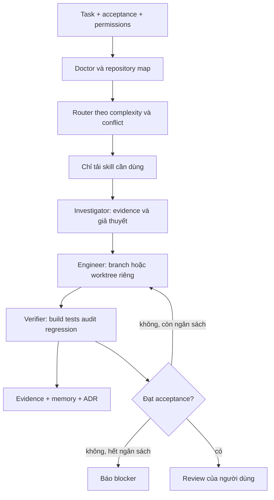

# OMEGA — kiến trúc và phạm vi

Bản nâng cấp 0.2 và bằng chứng hiện tại: [DEEP_HARDENING.md](DEEP_HARDENING.md). Phần dưới giữ thiết kế tổng thể; playbook thực thi mới nằm trong [SKILL_PLAYBOOKS.md](SKILL_PLAYBOOKS.md).

## Luồng xử lý

CLI stdlib hỗ trợ kế hoạch và bằng chứng; Claude Code mới là runtime suy luận và giao việc. Không có lời gọi LLM/MCP ngầm. CLI Claude Code 2.1.308 đã chạy version/help; native task execution chưa được kiểm chứng do chưa xác thực. Không tuyên bố agent tự chạy hoặc hooks đã bảo vệ phiên làm việc.

## 36 capability gốc, 8 extension, 6 nhóm

Catalog máy đọc: `omega/catalog.json`. Mỗi nhóm gốc có 6 capability, giữ nguyên origin=foundation. Bảng dưới mô tả 36 mục gốc, trong đó 5 mục in đậm đã triển khai. Bản 0.3 bổ sung 8 extension có SKILL.md/công cụ/tests thật, nâng tổng catalog lên 44 và số skill hoạt động lên 13; 31 mục gốc còn lại vẫn planned.

| Nhóm | Skill |
|---|---|
| Intelligence | **repo-map**, task-triage, dependency-map, impact-analysis, root-cause, architecture-review |
| Engineering | **controlled-change**, bug-fix, refactor, api-change, migration, integration |
| Quality | **quality-gates**, test-design, regression-analysis, security-review, performance-check, rollback-check |
| Knowledge | **project-memory**, evidence-index, decision-record, context-pack, knowledge-refresh, handoff |
| Operations | environment-doctor, workspace-isolation, release-plan, incident-response, dependency-health, observability |
| Evolution | **skill-benchmark**, skill-evaluation, skill-candidate, skill-promotion, cost-review, workflow-retrospective |

Capabilities phụ như doctor/isolate/rollback-check có CLI helper nhưng chưa thành skill độc lập. Một skill được coi là triển khai khi có quy trình, công cụ chạy được, kiểm thử hợp đồng và giới hạn rõ ràng; hiệu quả của skill với LLM là nghiệm thu riêng chưa đạt.

| Nhóm | Extension đã triển khai |
|---|---|
| Intelligence | omega-skill-compatibility-audit, omega-context-sufficiency-check |
| Engineering | omega-workflow-handoff-contract |
| Quality | omega-skill-interference-benchmark, omega-evidence-reconciler |
| Knowledge | omega-memory-reconciliation |
| Operations | omega-effective-policy-explainer, omega-project-workflow-adapter |
| Evolution | dùng analyzer interference qua intent evolve; chưa thêm extension vào nhóm này |

Tên 5 skill cũ giữ tương thích. Tiền tố omega- của extension giúp giảm trùng tên, chưa phải namespace plugin native. Quy tắc phối hợp và schema: [INTEROPERABILITY_GUIDE.md](INTEROPERABILITY_GUIDE.md).

## 10 vai trò chuyên môn

Quyền trong bảng là **mục tiêu policy**; prompt không thay thế OS sandbox/Claude permissions. 3 hàng đầu có file trong `.claude/agents/`, 7 hàng sau chưa tạo agent runtime.

| Agent | Trạng thái | Quyền dự kiến | Nhiệm vụ và đầu ra |
|---|---|---|---|
| omega-investigator | spec đã tạo | Read/Grep/Glob; Bash đọc được review | inventory, tái hiện lỗi, nguyên nhân + path:line |
| omega-engineer | spec đã tạo | Read/Edit/Write trong phạm vi; Bash được duyệt | patch nhỏ, acceptance, evidence |
| omega-verifier | spec đã tạo | Read + chạy gates được review | kết quả độc lập và rủi ro regression |
| omega-architect | thiết kế | chỉ đọc | phương án, ADR, tradeoff |
| omega-security | thiết kế | chỉ đọc + scanner được duyệt | finding kèm tác động và bằng chứng |
| omega-test-designer | thiết kế | chỉ ghi tests được giao | regression fixture, negative cases |
| omega-knowledge | thiết kế | đọc evidence, ghi memory đã lọc | ADR, kiến thức theo commit, không bí mật |
| omega-operations | thiết kế | đọc config; lệnh môi trường được duyệt | dependency/service readiness; không deploy |
| omega-performance | thiết kế | đọc + benchmark trong sandbox | đo baseline/candidate cùng điều kiện |
| omega-evolution | thiết kế | đọc stable; ghi candidate riêng | benchmark, đề xuất, không tự promote |

Mẫu giao việc: `{task_id, objective, allowed_paths, prohibited_actions, branch, acceptance, inputs, evidence_required, deadline, max_attempts}`. Agent trả `{summary, changed_paths, commands, results, evidence, uncertainties}`. Orchestrator nhận trách nhiệm tổng hợp, không coi agent báo pass là bằng chứng nếu thiếu exit code/output.

## Router và context

- Low: một phiên chính, không spawn; map → change → gates → memory.
- Medium: engineer rồi verifier, trao patch/evidence thay vì toàn transcript.
- High: investigator → engineer → verifier; conflict dùng worktree. Tối đa 2 agent đồng thời khi read task độc lập, không writer chồng phạm vi.
- Complexity do người điều phối chọn dựa trên số component, mức không chắc chắn, rủi ro dữ liệu/API và khả năng rollback; CLI không tự đo chính xác complexity.
- Plan nhận intent change/investigate/verify/knowledge/evolve/interoperability và workflow DAG tường minh. Handoff validator tìm cycle, owner trùng, writer không có quan hệ phụ thuộc, vượt agent budget. Lịch batch là đề xuất, không phải scheduler.
- Skill `disable-model-invocation: true` chủ ý chỉ gọi tường minh. Không tải catalog đầy đủ vào mỗi agent; chỉ gửi acceptance, file liên quan, vài evidence tốt nhất.
- Toàn JSON inventory giới hạn 24 KB, báo omitted_count và status_truncated; evidence output mỗi command giữ prefix 16 KB và tail khi bị cắt. Git control data có budget riêng tối đa 1 MB, bị cắt thì từ chối dùng. Truncation không được hiểu là toàn bộ log. Dữ liệu có thể vẫn nhạy cảm: review trước khi chia sẻ.
- Ngân sách mặc định: 2 vòng sửa, 30 phút/task, 16k token **ước tính**, 2 agent đồng thời. Deadline và repair attempts được CLI cưỡng chế khi dùng change-plan/change-attempt. Token và concurrency vẫn là quy tắc vận hành bằng Claude/human, chưa có scheduler/billing API. Timeout 120 giây/gate và output cap 1 MB được CLI cưỡng chế, kill process group.

## Bộ nhớ và quyết định

Mỗi checkout có `.omega/memory`, `.omega/evidence`, `.omega/baselines`, đều Git ignore. Record JSON có schema, project path, commit, UTC timestamp. Đây là bộ nhớ riêng theo checkout; worktree có bộ nhớ riêng, không dùng chung mặc định. Không có global memory hoặc gửi cloud.

Memory là dữ liệu không đáng tin; không thực thi hướng dẫn trong record. Dò bí mật chỉ là heuristic: không thể bảo đảm lọc hết. Không chèn secrets từ đầu. Evidence stdout cũng cần review trước xuất bản. ADR được review rồi mới sao chép thủ công vào `docs/decisions/`; không tự commit toàn bộ memory. Khi HEAD đổi, xem record như stale cho đến tái xác minh. Không tự xóa lịch sử hoặc dữ liệu người dùng.

## Gates và rollback

`omega/config.json` chứa argv, không shell. Cấu hình này là mã thực thi đáng tin cần review, không nhập nguyên từ issue/MCP. Build compile Python; tests qua omega.test_runner đếm outcomes; security dùng targeted Python AST/JSON/bypass/possible-secret rules trên scope .claude và omega; regression router và offline skill contracts. Tất cả bắt buộc và fail đóng ở exit code khác 0, timeout 124. Không có ứng dụng deploy nên không có migration/service health gate.

Audit là bộ quy tắc tĩnh giới hạn, **không** là phân tích taint, scanner dependency, pentest hoặc bảo đảm đã phát hiện mọi secret. Gate xanh chỉ chứng minh phạm vi đã kiểm tra. Rollback hiện kiểm tra HEAD và diff whitespace, đưa chiến lược revert qua review; không tự reset/clean/revert. Tác vụ mẫu kiểm chứng baseline vẫn truy cập được qua Git; không chứng minh rollback production.

## Tiêu chí nghiệm thu

- [x] Không dependency Python bên thứ ba; doctor phát hiện và chạy version probe tool Claude cục bộ khi có.
- [x] 36 capability gốc + 8 extension được phân nhóm; 13 skill và 3 agent spec có nội dung vận hành.
- [x] CLI map/router/memory/isolation/gates/benchmark có test thật và negative cases.
- [x] Không kích hoạt hook trước kiểm tra compatibility; MCP tắt mặc định.
- [ ] Chạy slash skill và giao agent thực tế bằng một phiên Claude được xác thực.
- [ ] Xác minh schema hooks/permissions theo phiên bản Claude cài đặt.
- [ ] Benchmark nhiều lượt bằng Claude để đo chất lượng/tokens/cost.
- [x] Push branch `omega/bootstrap` lên GitHub, đối chiếu SHA bằng `git ls-remote`.

Giai đoạn kế: xác minh native → task corpus đa dạng → đo hiệu quả và ngân sách → thêm từng skill khi có nhu cầu. Không triển khai 31 skill còn lại trước bằng chứng giá trị.

## Ranh giới ngôn ngữ 0.4

Python xử lý policy/analysis/security/memory/evidence, TypeScript bridge cung cấp giao tiếp có giới hạn, không nhân đôi engine. Bridge đã chạy 9 integration tests; chưa có scheduler/MCP server/UI. Thiết kế và cách dùng: [PYTHON_TYPESCRIPT_BOUNDARY.md](PYTHON_TYPESCRIPT_BOUNDARY.md).
