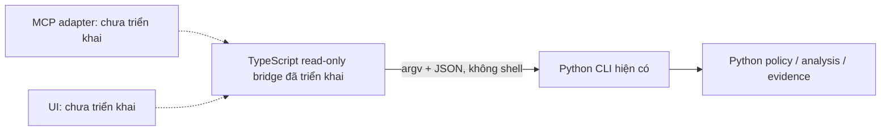

# Python xử lý chính, TypeScript điều phối và giao tiếp

## Quyết định

Theo khuyến nghị của người dùng, Python là lõi OMEGA: repository analysis, policy, security rules, test outcome adapters, evidence, memory, candidate/benchmark và repair ledger. TypeScript dùng cho lớp điều phối/giao tiếp; MCP và UI sau này gọi cùng giao thức Python, không viết lại quy tắc ở ba nơi.

Đã triển khai bridge TypeScript đọc dữ liệu thật từ Python tại `integration/typescript/omega-bridge.ts`. Có 15 test Node gọi engine thực tế, kiểm tra tương đương JSON, giới hạn output/timeout, chặn command ghi, path escape, symlink và giữ nguyên semantic failure exit 1. Đây là facade local, không phải agent scheduler, MCP server hoặc UI đã được triển khai.



## Dùng bridge

Node >=24, Python >=3.10, Git, POSIX. Bridge runtime không cần package ứng dụng bên thứ ba, service hoặc port. Full engine build cần npm ci cho dev compiler/type definitions đã pin; xem UPGRADE_0_5.md. Node chạy TypeScript bằng type stripping; build gate chạy strict tsc/noEmit với TypeScript 7.0.2 (compiler native) và @types/node 24.19.2 đã pin (giữ nhánh 24 khớp runtime Node 24). Node kiểm chứng local: 24.19.0. CI cấu hình đúng phiên bản, action setup-node pin SHA tag đã kiểm tra.

```bash
node --test integration/typescript/omega-bridge.test.mjs
node --check integration/typescript/omega-bridge.ts
node integration/typescript/omega-bridge.ts --project-root /ABS/PROJECT <<'JSON'
{"command":"plan","complexity":"high","conflict":true}
JSON
```

API: `runReadOnly(request, trustedProjectRoot, options?)` trả `{exitCode,result,scope}`. Request có command và các trường phù hợp: input/record/selections/skillRoots/hookConfigs/complexity/conflict. Unknown fields, command ghi, option không phù hợp hoặc path thoát root bị từ chối. Python tiếp tục kiểm tra artifact schema, Git root, private path và symlink; TypeScript không cấp quyền mới.

Commands cho phép: map/plan/audit/context/memory-read, các command phân tích interoperability/evidence/memory/context. Không expose gates, isolate, memory write, candidate, compare, change-attempt, push hoặc deploy. Doctor cũng không expose vì có thể ghi state probe.

Root phải do ứng dụng gọi bridge cấu hình tin cậy, không lấy tự do từ payload MCP/web. Python executable trong options là cấu hình của host; request không được đặt executable hoặc raw argv. stdin/API tối đa 16 KiB; --timeout-ms mặc định 15 giây áp dụng cả stdin và Python, API hỗ trợ AbortSignal; output tổng stdout/stderr 128 KiB, kill process group/close pipes khi vượt và chờ child close. Không trả JSON bị cắt như success. Các giới hạn này không thay OS sandbox hoặc authentication của server sau này.

## Ranh giới MCP và UI giai đoạn sau

MCP: dùng SDK chính thức đã pin/review khi thực sự có client cần kết nối; tools đọc mặc định, explicit project allowlist, schema mapping và cancellation về Python. Không expose root/executable/argv tùy ý, không import credential từ request. Verify protocol/version/client và permission behavior trước đăng ký server. Chưa cài SDK hoặc sửa config Claude/MCP.

UI: TypeScript cho hiển thị status/artifact/diff, giữ JSON evidence references, render nội dung nguồn như text không đáng tin. Nếu thêm API server phải có authentication, project allowlist và quyền write riêng; UI không dùng contract score như điểm chất lượng LLM. Chưa mở port, tạo frontend giả hoặc deploy.

Tác vụ mutation tiếp tục qua CLI Python có quyền đã review. Chỉ mở thêm tool mutation khi có use case, acceptance và authorization cụ thể; bridge không tự tăng quyền để làm workflow thuận tiện.
